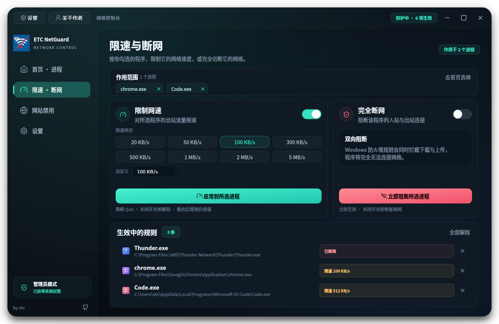
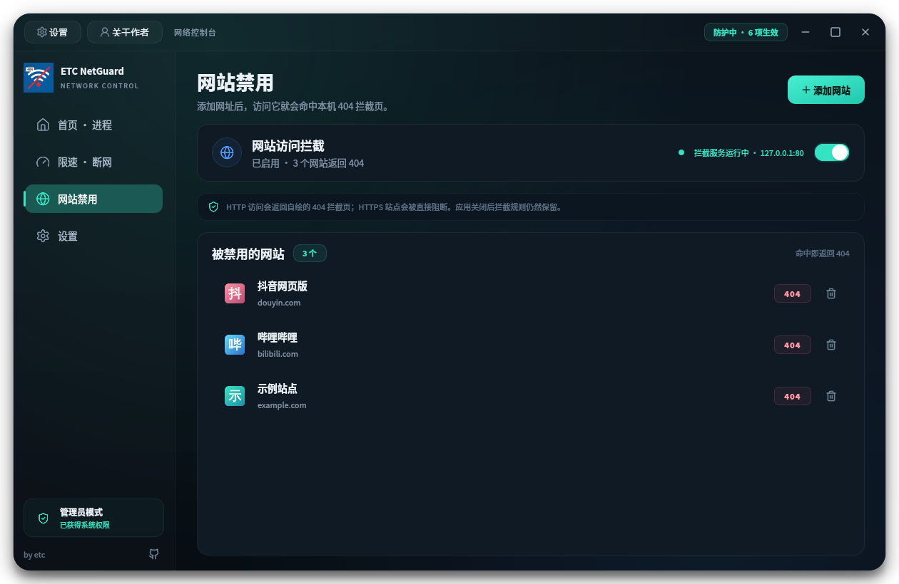
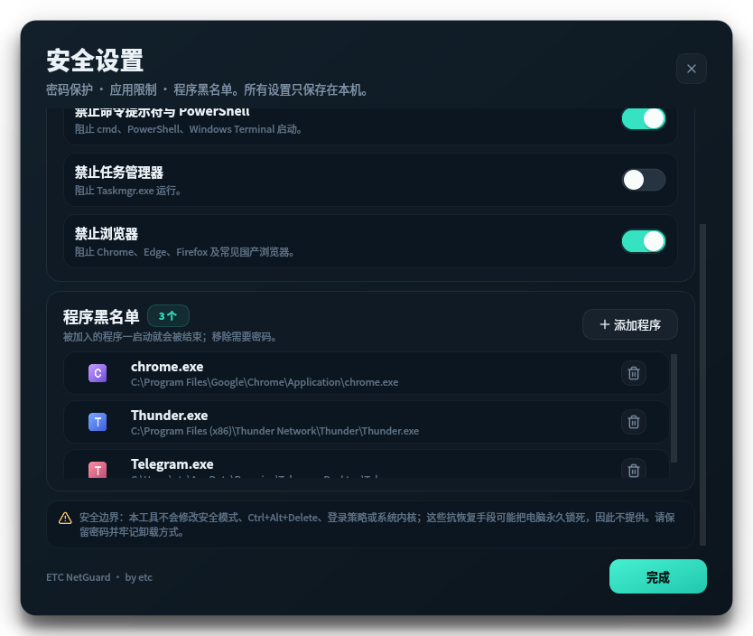
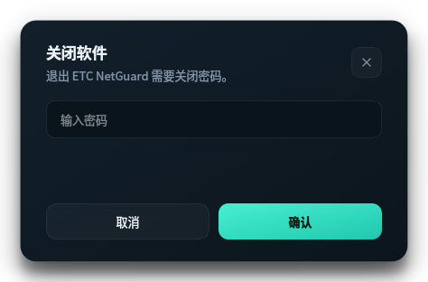
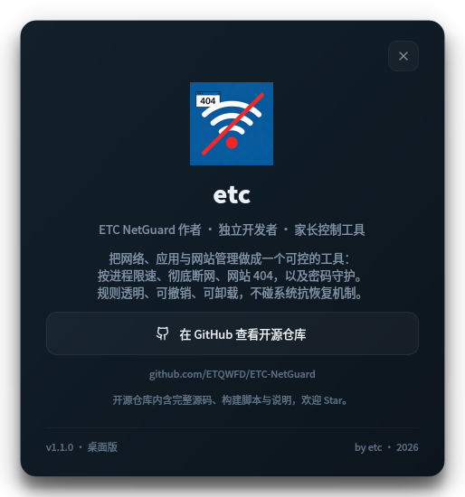

# ETC NetGuard

一款给 Windows 电脑用的本地网络与家长控制工具。作者 **etc**。

按进程限速 / 彻底断网、让指定网站返回 **404**、程序黑名单、关闭密码、托盘互锁，界面是深色无边框卡片风格。

> 设计目的：防止孩子或其他人随意改动电脑的网络、关闭软件或运行不该运行的程序。它是**可撤销、可卸载**的管理工具，不是不可恢复的锁机软件。


## 功能

- **真实限速 / 断网**：Windows QoS 策略按进程路径限速（界面 KB/s 会换算成 QoS 的 bit/s）；防火墙出站规则彻底断网。规则写入系统后立即生效，可在软件内一键清除。
- **网站 404 拦截**：hosts 将域名指向 127.0.0.1，本地 HTTP 服务返回 404；支持 `www.` 与主域名同时拦截。HTTPS 站点由于浏览器证书校验，通常会显示连接失败/重试页，而不是伪造的 404 页面。
- **进程列表**：真实进程图标、CPU / 内存、多实例聚合、自动刷新并保持勾选。
- **程序黑名单**：按 exe 路径阻止运行，带程序图标；右键可移除，启用密码时需验证。
- **关闭密码**：PBKDF2-HMAC-SHA256 加盐散列，不保存明文。退出、托盘退出、从托盘打开主窗口、清除规则、移出黑名单均需密码。
- **托盘驻留**：启用密码时，关闭主窗口需验证并隐藏到托盘；托盘菜单“显示控制台/退出”也需要密码。未启用密码时，关闭主窗口直接退出。
- **应用限制**：可切换禁止命令提示符 / PowerShell / Windows Terminal、任务管理器、常见浏览器。
- **C 原生关闭守卫**：`native/etc_guard.c` 编译为 x64 DLL，子类化窗口拦截 `WM_CLOSE`，关闭请求交由 Python 密码弹窗处理；另有单实例互斥与进程终止辅助。
- **七步新手引导**：首次启动逐步介绍限速、断网、网站 404、安全设置与托盘行为。
- **现代安装包**：NSIS Modern UI 2 中文安装程序，许可协议、组件选择、桌面/开始菜单快捷方式、卸载保留或删除配置。

| 限速与断网 | 网站 404 |
|---|---|
|  |  |

| 安全设置 | 程序黑名单 |
|---|---|
|  |  |

| 关闭密码 | 关于作者 |
|---|---|
|  |  |

## 下载

从 [Releases](https://github.com/ETQWFD/ETC-NetGuard/releases) 下载：

| 文件 | 说明 |
|---|---|
| `ETC-NetGuard.exe` | 免安装单文件版，需管理员权限 |
| `ETC-NetGuard-Setup-1.1.0.exe` | NSIS 安装程序（推荐） |
| `etc-code-signing.cer` | 作者自签名代码签名**公钥证书**，可导入“受信任的根证书颁发机构” |
| `SHA256SUMS.txt` | 各产物的 SHA-256 校验值 |

安装包与 EXE 使用作者自签名证书（主题 `etc`），不是商业 CA 证书。Windows 首次运行可能提示“未知发布者”或 SmartScreen；把 `etc-code-signing.cer` 导入“受信任的根证书颁发机构”后可消除本机警告。请核对 SHA-256 后再运行。

证书 SHA-256 指纹：`68:FC:F1:E6:64:4B:B2:50:CF:06:2C:64:6C:53:3D:31:5D:8E:BB:8A:A6:60:56:2C:70:82:31:F2:17:96:A5:7F`

仓库只提交源码、截图、构建脚本与**公钥证书**；EXE、安装包和私钥不进 git（私钥绝不公开）。二进制从 Releases 下载。

## 使用

1. 安装或直接运行 `ETC-NetGuard.exe`（会请求管理员权限）。
2. 首次启动跟随七步引导。
3. 首页勾选进程 → “限速”输入 KB/s 或选择“彻底断网” → 应用。
4. “网站 404”页添加域名，打开总开关。
5. 左上角“设置” → “安全设置”：启用关闭密码、应用限制、添加程序黑名单。
6. 关闭主窗口会留在托盘；托盘右键“显示控制台 / 退出”在启用密码时需要验证。

## 安全边界（请阅读）

- 本软件**不修改** Windows 安全模式、登录策略、系统内核，**不拦截** `Ctrl+Alt+Delete`，也不承诺阻止所有“非正常手段”。这类抗恢复操作实现不当可能把电脑永久锁死，因此明确不提供。
- 所有限制都是可撤销的：停止软件、卸载软件或在安全模式下移除规则即可恢复网络。
- 卸载程序不要求密码，以保证设备所有者始终可以恢复。卸载时可选择保留或删除 `%APPDATA%\ETCNetGuard\config.json`。
- 请只在您有权管理的设备上使用；不要用于恶意锁机、勒索或限制他人人身自由。

## 从源码构建

Windows 原生构建：

```bat
py -3 -m pip install pyinstaller PyQt5==5.15.11
build_win.bat
```

Linux 交叉构建（本仓库开发环境，Wine + Windows embeddable Python 3.8）：

```bash
./build_win.sh          # 产出 dist/ETC-NetGuard.exe
```

安装包：

```bash
makensis installer/installer.nsi
```

自签名（可选）：

```bash
osslsigncode sign -pkcs12 etc-codesign.pfx -pass <password> \
  -n "ETC NetGuard" -i https://github.com/ETQWFD/ETC-NetGuard \
  -in dist/ETC-NetGuard.exe -out dist/ETC-NetGuard-signed.exe
```

## 源码结构

```
etc_netguard/
  backend.py          QoS / 防火墙 / hosts / 404 服务 / 进程扫描
  state.py            配置、密码散列、黑名单
  security.py         守卫线程、保护名单、浏览器/命令行匹配
  security_dialogs.py 密码、安全设置、黑名单弹窗
  native.py           C DLL 加载与关闭请求轮询
  main_window.py      主窗口、托盘、密码门禁、规则编排
  pages.py            首页 / 限速 / 网站 / 设置
  onboarding.py       七步引导
  widgets.py          自绘开关、卡片、表格
  theme.py            颜色、字体、圆角
native/etc_guard.c    Win32 关闭守卫 DLL 源码
assets/               图标、版本信息、已编译 DLL
installer/            NSIS 脚本、许可协议、安装界面素材
preview/shots/        界面截图
```

## 许可

MIT License，见 [LICENSE](LICENSE)。软件名称、图标与作者署名归 etc 所有。
